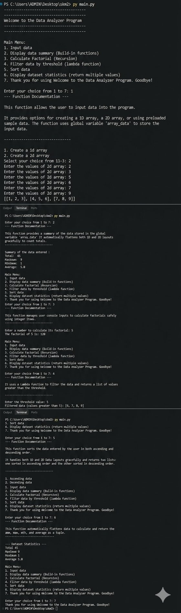

# 1. Project Title

## Data Analyzer Program

A Python-based console application for entering, analyzing, filtering, sorting, and calculating statistics from numerical 1D and 2D datasets.

---

# 2. Project Description

The **Data Analyzer Program** is a menu-driven Python application that allows users to perform different operations on numerical datasets.

The program supports both **1D arrays** and **2D arrays**. Users can either enter their own data or use the preloaded sample datasets.

The application provides features such as:

* Displaying a summary of the dataset
* Calculating total, maximum, minimum, and average
* Calculating factorial using recursion
* Filtering data using a threshold
* Sorting data in ascending and descending order
* Displaying multiple dataset statistics
* Converting 2D data into a 1D format for analysis

This project demonstrates important Python programming concepts such as functions, lists, nested lists, loops, conditional statements, recursion, lambda functions, built-in functions, multiple return values, keyword arguments, docstrings, and user input validation.

The program uses a simple command-line interface where users can select different operations from the main menu.

---

# 3. Features

## 3.1 Input Data

Users can enter and store their own numerical data.

The program supports:

* Custom 1D arrays
* Custom 2D arrays
* Sample 1D array
* Sample 2D array

### Sample 1D Array

```python
[910, 20, 30, 40, 50, 60, 20, 1863, 12, 123, 50]
```

### Sample 2D Array

```python
[,
 ,
    [300, 500, 422]
]
```

---

## 3.2 Data Summary

The program calculates and displays:

* **Total**
* **Maximum**
* **Minimum**
* **Average**

The summary works with both 1D and 2D datasets.

---

## 3.3 Factorial Calculation

The program calculates the factorial of a number using a **recursive function**.

Example:

```text
5! = 5 × 4 × 3 × 2 × 1
5! = 120
```

This feature demonstrates the concept of **recursion in Python**.

---

## 3.4 Filter Data

Users can provide a threshold value to filter the dataset.

The program displays values that are greater than the specified threshold.

This feature uses a **lambda function** with Python's `filter()` function.

Example:

```text
Data: [10, 20, 30, 40, 50]
Threshold: 25

Result: [30, 40, 50]
```

---

## 3.5 Sort Data

The program sorts the dataset in two different ways:

* Ascending order
* Descending order

Example:

```text
Original Data:
[40, 10, 30, 20]

Ascending:
[10, 20, 30, 40]

Descending:
[40, 30, 20, 10]
```

The program supports sorting both 1D and 2D datasets.

---

## 3.6 Dataset Statistics

The program calculates multiple statistics and returns them together:

* Total
* Maximum
* Minimum
* Average

The `display_statistics()` function demonstrates **multiple return values** in Python.

Example:

```python
total, maximum, minimum, average = display_statistics(data)
```

---

## 3.7 1D and 2D Data Conversion

The `conv()` function converts a 2D array into a 1D list.

For example:

```python
[,
 ,
    [300, 500, 422]
]
```

is converted into:

```python
[200, 123, 120, 150, 260, 52, 300, 500, 422]
```

This allows the same analysis functions to process both 1D and 2D datasets.

---

## 3.8 Function Documentation

The program contains **docstrings** for its functions.

Before performing an operation, the program displays the documentation of the relevant function.

This makes it easier for users to understand what each function does.

---

## 3.9 Keyword Arguments

The `keyw()` function demonstrates the use of variable-length keyword arguments using:

```python
**kwargs
```

It is used to display the calculated dataset statistics.

---

## 3.10 Input Validation

The program validates menu input to ensure that the user enters a numeric choice.

For invalid input, the program displays an error message and asks the user to enter a valid choice.

---

## 3.11 Menu-Driven Interface

The program provides the following main menu:

```text
Main Menu:

1. Input data
2. Display data summary
3. Calculate Factorial
4. Filter data by threshold
5. Sort data
6. Display dataset statistics
7. Exit
```

The program continues running until the user selects option `7`.

---

# 4. Technologies Used

## Core Language & Software

* **Python 3** – The core programming language used to build the application.
* **Visual Studio Code (VS Code)** – The Integrated Development Environment (IDE) used for writing and debugging the code.
* **Git** – Version control system used for tracking changes and managing source code history.
* **GitHub** – Cloud platform used for hosting the repository and collaboration.

## Python Concepts

The project demonstrates:

* Variables
* Lists
* 1D arrays
* 2D arrays
* Nested lists
* Functions
* Function arguments
* Global variables
* `if` statements
* `for` loops
* `while` loops
* List comprehensions
* Recursion
* Lambda functions
* `filter()`
* `sorted()`
* `sum()`
* `max()`
* `min()`
* Multiple return values
* Keyword arguments (`**kwargs`)
* Docstrings
* User input
* Input validation

## External Libraries

No external libraries are required.

The project uses only Python's built-in functionality.

---

# 5. How to Run | Installation

## Prerequisites

Make sure **Python 3** is installed on your computer.

Check the Python version using:

```bash
python --version
```

If your system uses `python3`, use:

```bash
python3 --version
```

---

## Installation

### Step 1: Download the Project

Download the project files to your computer.

If the project is hosted on GitHub, you can clone it using:

```bash
git clone <repository-url>
```

Then navigate to the project directory:

```bash
cd <project-folder>
```

### Step 2: Install Dependencies

No additional packages or external libraries are required.

The project uses only standard Python functionality.

---

## Run the Program

Save the Python source code as:

```text
data_analyzer.py
```

Open a terminal or command prompt inside the project directory.

Run:

```bash
python data_analyzer.py
```

Or, on systems using `python3`:

```bash
python3 --version
```

---

## Program Menu

After running the program, the following menu will appear:

```text
Main Menu:
1. Input data
2. Display data summary (Built-in functions)
3. Calculate Factorial (Recursion)
4. Filter data by threshold (lambda function)
5. Sort data
6. Display dataset statistics (return multiple values)
7. Exit

Enter your choice from 1 to 7:
```

Select an option from `1` to `7` and follow the instructions displayed by the program.

---

# 6. Project Structure

The project can be organized as follows:

```text
├── main.py
|
├── output.png
│
└── README.md
```


### `data_analyzer.py`

Contains the complete Python application, including:

* Sample datasets
* Data input functionality
* Data summary
* Factorial calculation
* Data filtering
* Data sorting
* Data conversion
* Dataset statistics
* Keyword argument functionality
* Main menu

### `README.md`

Contains the project documentation, including:

* Project title
* Project description
* Features
* Technologies used
* Installation instructions
* Running instructions
* Project structure
* Author information

---
# 7. Output & Screenshots

This section showcases the terminal execution and interface behavior of the Data Analyzer Program.

### Main Menu Interface


# 8. Author | Developer Name

**Developer:** SRIJAN KUMAR

**Project:** Data Analyzer Program

**Language:** Python 3

---

